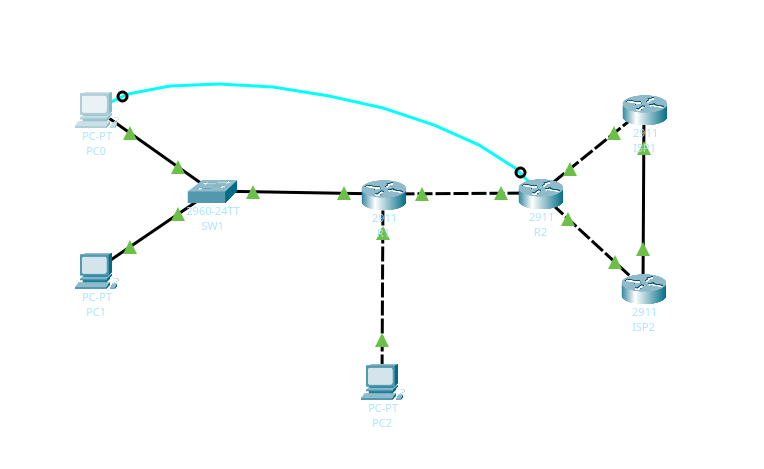
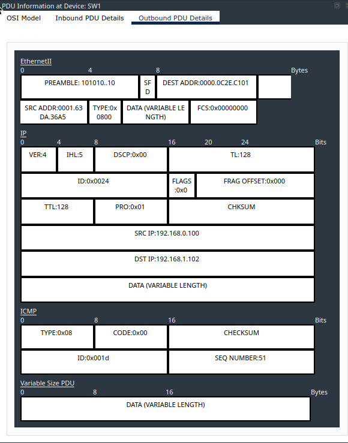
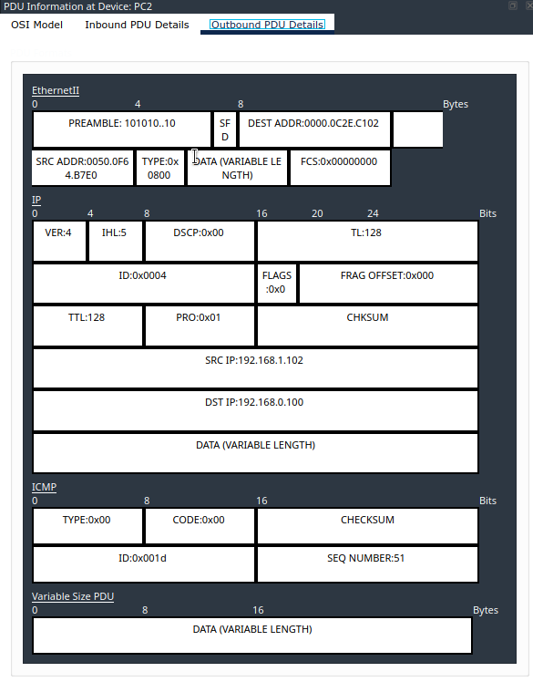
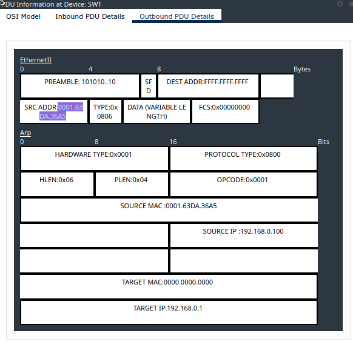
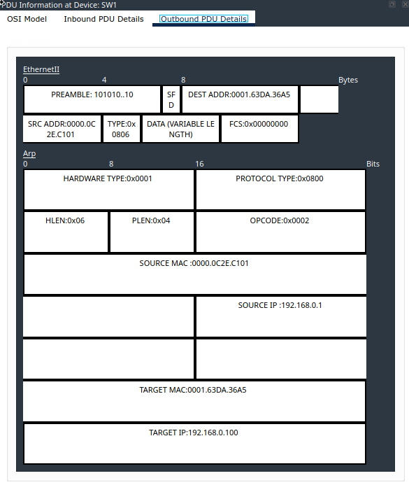

# Отчет по лабораторной работе 1.1
**Тема:** Базовая настройка, ARP, статическая маршрутизация  
**Выполнили:** Капустин Михаил, Екатерина Поликарпова, Веселова Валерия

## Часть 1: Создание топологии и начальная конфигурация устройств

### Шаг 1

**1.** Собрали сеть в `lab 1.1.pka` по таблице подключений:

| От устройства | Порт | К устройству | Порт |
|---|---|---|---|
| R1 | Gi0/0 | SW1 | Gi0/1 |
| R1 | Gi0/1 | PC2 | Fa0 |
| R1 | Gi0/2 | R2 | Gi0/2 |
| R2 | Gi0/0 | ISP1 | Gi0/0 |
| R2 | Gi0/1 | ISP2 | Gi0/0 |
| SW1 | Fa0/10 | PC0 | Fa0 |
| SW1 | Fa0/11 | PC1 | Fa0 |



**2.** Базовая конфигурация через консольное подключение. Пункты 2.1–2.6 выполнены одним блоком на каждом устройстве (меняется только `hostname`).

Расшифровка команд:

| Пункт | Команда | Назначение |
|---|---|---|
| 2.1 | `hostname <имя>` | Имя устройства. `Display Name` изменён двойным кликом на иконке |
| 2.2 | `no ip domain-lookup` | Опечатка в команде больше не воспринимается как имя узла для DNS-запроса |
| 2.3 | `service password-encryption` | Шифрование паролей в конфигурации |
| 2.4 | `enable secret cisco` | Секрет привилегированного режима |
| 2.5 | `username admin privilege 15 secret cisco` | Локальный пользователь с максимальными правами |
| 2.6 | `logging synchronous`, `login local`, `speed 115200` на `line console 0` | Синхронизация вывода, аутентификация по локальной базе, скорость консоли |

**R1**
```text
Router> enable
Router# configure terminal
Router(config)# hostname R1
R1(config)# no ip domain-lookup
R1(config)# service password-encryption
R1(config)# enable secret cisco
R1(config)# username admin privilege 15 secret cisco
R1(config)# line console 0
R1(config-line)# logging synchronous
R1(config-line)# login local
R1(config-line)# speed 115200
R1(config-line)# exit
```

**R2**
```text
Router> enable
Router# configure terminal
Router(config)# hostname R2
R2(config)# no ip domain-lookup
R2(config)# service password-encryption
R2(config)# enable secret cisco
R2(config)# username admin privilege 15 secret cisco
R2(config)# line console 0
R2(config-line)# logging synchronous
R2(config-line)# login local
R2(config-line)# speed 115200
R2(config-line)# exit
```

**SW1**
```text
Switch> enable
Switch# configure terminal
Switch(config)# hostname SW1
SW1(config)# no ip domain-lookup
SW1(config)# service password-encryption
SW1(config)# enable secret cisco
SW1(config)# username admin privilege 15 secret cisco
SW1(config)# line console 0
SW1(config-line)# logging synchronous
SW1(config-line)# login local
SW1(config-line)# speed 115200
SW1(config-line)# exit
```

**3.** IP-адреса, шлюзы и описания по таблице адресации.

**R1**
```text
R1(config)# interface GigabitEthernet0/0
R1(config-if)# description LAN1
R1(config-if)# ip address 192.168.0.1 255.255.255.0
R1(config-if)# no shutdown
R1(config-if)# interface GigabitEthernet0/1
R1(config-if)# description LAN2
R1(config-if)# ip address 192.168.1.1 255.255.255.128
R1(config-if)# no shutdown
R1(config-if)# interface GigabitEthernet0/2
R1(config-if)# description UPLINK
R1(config-if)# ip address 10.10.12.2 255.255.255.252
R1(config-if)# no shutdown
R1(config-if)# end
```

**R2**
```text
R2(config)# interface GigabitEthernet0/0
R2(config-if)# description ISP1
R2(config-if)# ip address 100.0.102.130 255.255.255.252
R2(config-if)# no shutdown
R2(config-if)# interface GigabitEthernet0/1
R2(config-if)# description ISP2
R2(config-if)# ip address 100.0.202.130 255.255.255.252
R2(config-if)# no shutdown
R2(config-if)# interface GigabitEthernet0/2
R2(config-if)# description DOWNLINK
R2(config-if)# ip address 10.10.12.1 255.255.255.252
R2(config-if)# no shutdown
R2(config-if)# end
```

**SW1** (управляющий интерфейс и шлюз)
```text
SW1(config)# interface vlan 1
SW1(config-if)# description MGMT
SW1(config-if)# ip address 192.168.0.254 255.255.255.0
SW1(config-if)# no shutdown
SW1(config-if)# exit
SW1(config)# ip default-gateway 192.168.0.1
SW1(config)# end
```

**Компьютеры** (вкладка `Desktop` → `IP Configuration`, статическая адресация):

| Устройство | IP | Маска | Шлюз |
|---|---|---|---|
| PC0 | 192.168.0.100 | 255.255.255.0 | 192.168.0.1 |
| PC1 | 192.168.0.101 | 255.255.255.0 | 192.168.0.1 |
| PC2 | 192.168.1.102 | 255.255.255.128 | 192.168.1.1 |

**4.** Сохранили конфигурацию на всех устройствах:
```text
R1# copy running-config startup-config
Destination filename [startup-config]? 
Building configuration...
[OK]
```
То же выполнено на `R2` и `SW1`.

### Шаг 2

Проверили связность с `PC0`, затем посмотрели таблицы:

```text
C:\> ping 192.168.0.101
Pinging 192.168.0.101 with 32 bytes of data:

Reply from 192.168.0.101: bytes=32 time<1ms TTL=128
Reply from 192.168.0.101: bytes=32 time<1ms TTL=128
Reply from 192.168.0.101: bytes=32 time<1ms TTL=128
Reply from 192.168.0.101: bytes=32 time<1ms TTL=128

Ping statistics for 192.168.0.101:
    Packets: Sent = 4, Received = 4, Lost = 0 (0% loss),
Approximate round trip times in milli-seconds:
    Minimum = 0ms, Maximum = 0ms, Average = 0ms

C:\> ping 192.168.1.102
Pinging 192.168.1.102 with 32 bytes of data:

Request timed out.
Reply from 192.168.1.102: bytes=32 time<1ms TTL=127
Reply from 192.168.1.102: bytes=32 time<1ms TTL=127
Reply from 192.168.1.102: bytes=32 time<1ms TTL=127

Ping statistics for 192.168.1.102:
    Packets: Sent = 4, Received = 3, Lost = 1 (25% loss),
Approximate round trip times in milli-seconds:
    Minimum = 0ms, Maximum = 0ms, Average = 0ms

SW1# show mac address-table
SW1#show mac address-table
          Mac Address Table
-------------------------------------------

Vlan    Mac Address       Type        Ports
----    -----------       --------    -----

   1    0000.0c2e.c101    DYNAMIC     Gig0/1
   1    0001.63da.36a5    DYNAMIC     Fa0/10
   1    00e0.a3d3.6692    DYNAMIC     Fa0/11

C:\> arp -a
C:\>arp -a
  Internet Address      Physical Address      Type
  192.168.0.1           0000.0c2e.c101        dynamic
  192.168.0.101         00e0.a3d3.6692        dynamic

R1# show ip arp
Protocol  Address          Age (min)  Hardware Addr   Type   Interface
Internet  10.10.12.1              6   0005.5E78.A803  ARPA   GigabitEthernet0/2
Internet  10.10.12.2              -   0000.0C2E.C103  ARPA   GigabitEthernet0/2
Internet  192.168.0.1             -   0000.0C2E.C101  ARPA   GigabitEthernet0/0
Internet  192.168.0.100           7   0001.63DA.36A5  ARPA   GigabitEthernet0/0
Internet  192.168.1.1             -   0000.0C2E.C102  ARPA   GigabitEthernet0/1
Internet  192.168.1.102           1   0050.0F64.B7E0  ARPA   GigabitEthernet0/1
```

**Ответы на вопросы:**

1. **Эхо-запросы проходят успешно?** Да, на оба узла. Первый запрос обычно теряется (`Request timed out`), остальные три получают `Reply`. Причина потери: при первом обращении на PC0 нет ARP-записи, и пока идёт ARP-запрос, ICMP-пакет ждёт разрешения MAC-адреса. До `PC1` (`192.168.0.101`) пакет идёт напрямую внутри LAN1. До `PC2` (`192.168.1.102`) пакет идёт через шлюз R1, который маршрутизирует его между сетями `192.168.0.0/24` и `192.168.1.0/25` по подключённым маршрутам. Для пинга не нужны ни статические маршруты, ни `ip default-gateway` на SW1. 

2. **Таблица коммутации SW1.** В ней три динамических записи в `VLAN 1`:

   | MAC | Порт | Чей MAC |
   |---|---|---|
   | `<MAC-PC0>` | Fa0/10 | PC0 |
   | `<MAC-PC1>` | Fa0/11 | PC1 |
   | `<MAC-R1-Gi0/0>` | Gi0/1 | R1 Gi0/0 |

   Коммутатор учится по `SRC MAC` входящих кадров. MAC-адрес `PC2` в таблице отсутствует: PC2 стоит за маршрутизатором, в LAN1 приходят кадры с `SRC MAC` интерфейса `R1 Gi0/0`. Поэтому всё, что находится за R1, отображается как MAC R1 на порту Gi0/1.

3. **Таблицы ARP.**
   - **PC0** содержит две записи: `192.168.0.101` → `<MAC-PC1>` (прямая доставка до PC1) и `192.168.0.1` → `0000.0C2E.C101` (шлюз, через который шёл пинг до PC2). Записи для `192.168.1.102` на PC0 нет: адреса из чужих подсетей PC0 не резолвит, он узнаёт только MAC шлюза.
   - **R1** содержит записи `192.168.0.100` → `0001.63DA.36A5` (клиент в LAN1, прислал запрос), `192.168.1.102` → `0050.0F64.B7E0` (R1 резолвил его при пересылке эхо-запроса в LAN2) и собственные адреса интерфейсов `192.168.0.1` и `192.168.1.1`.

## Часть 2: Роль IP и MAC адреса при прямой и косвенной пересылке

### Шаг 1

Перешли в режим `Simulation`, в `Edit Filters` оставили только `ICMP` и отправили эхо-запрос с `PC0` на `PC2` (`192.168.1.102`).

### Шаг 2

Открыли пакет на `PC0` (`Outbound PDU Details`).



* **DEST MAC:** `0000.0C2E.C101`, то есть MAC-адрес шлюза по умолчанию, а не PC2. `PC2` (`192.168.1.102`) находится в другой подсети, чем `PC0` (`192.168.0.0/24`). Это косвенная пересылка: PC0 не может передать кадр получателю напрямую, поэтому адресует кадр шлюзу `192.168.0.1`, а IP-адрес назначения при этом остаётся `192.168.1.102`.

Дошли до `R1` и открыли `Outbound PDU Details`.



* **SRC и DEST MAC:** `SRC MAC` = `0050.0F64.B7E0` (исходящий интерфейс R1 в LAN2), `DEST MAC` = `0000.0C2E.C102`. Маршрутизатор принял кадр, удалил старый Ethernet-заголовок и сформировал новый для следующего сегмента (LAN2): отправитель — его интерфейс `Gi0/1`, получатель — PC2, который находится в этой сети (последний переход, прямая доставка). IP-адреса в пакете не меняются (`SRC IP` = `192.168.0.100`, `DEST IP` = `192.168.1.102`). MAC-адреса переписываются на каждом L3-переходе, IP-адреса остаются прежними от отправителя до получателя.

## Часть 3: Протокол ARP

### Шаг 1

Вышли из режима симуляции, очистили ARP-таблицу на `PC0`, включили симуляцию, оставили фильтр `ARP` и отправили эхо-запрос с `PC0` на `R1` (`192.168.0.1`).

```text
C:\> arp -d
C:\> arp -a
No ARP Entries Found
C:\> ping 192.168.0.1
```

### Шаг 2

Открыли ARP-сообщение на `PC0`.



1. **TYPE** в Ethernet-кадре: `0x0806`, значение, которое обозначает ARP.
2. **DEST MAC:** `FFFF.FFFF.FFFF`, то есть широковещательный MAC-адрес. PC0 не знает MAC-адрес `192.168.0.1`, поэтому спрашивает всех в сегменте. Получив такой кадр, `SW1` отправит его на все порты `VLAN 1`, кроме порта, с которого кадр пришёл (в `PC1` и в `R1`). Одновременно SW1 запишет `SRC MAC` в таблицу как `Fa0/10`.
3. **OPCODE:** `1` (ARP Request).
4. **SOURCE MAC и SOURCE IP:** принадлежат PC0 (`0001.63DA.36A5`, `192.168.0.100`), отправителю запроса.
5. **TARGET MAC:** `0000.0000.0000`. Это поле ARP-запроса, которое и нужно узнать, поэтому оно не заполнено. `TARGET IP` = `192.168.0.1`.

Дошли до `R1`, открыли `Outbound PDU Details`.



1. **DEST MAC:** `0001.63DA.36A5`, то есть unicast-адрес запросившего (R1 взял его из `SOURCE MAC` запроса). Это уже не широковещание. `SW1` ищет `0001.63DA.36A5` в таблице коммутации, находит запись для порта `Fa0/10` и отправляет кадр только туда, без рассылки на остальные порты.
2. **OPCODE:** `2` (ARP Reply).
3. **Принадлежность полей:** `SOURCE MAC` и `SOURCE IP` — это `R1 Gi0/0` (`0000.0C2E.C101`, `192.168.0.1`), то есть тот, кто отвечает и сообщает свой MAC. `TARGET MAC` и `TARGET IP` — это `PC0` (`0001.63DA.36A5`, `192.168.0.100`), кому адресован ответ. После получения ответа PC0 заносит в ARP-таблицу запись `192.168.0.1` → `<MAC-R1-Gi0/0>`.

## Часть 4: Настройка статической маршрутизации

### Шаг 1

Вышли из режима симуляции.

**1.** Выход из симуляции выполнен.

**2.** Рекурсивный маршрут по умолчанию на R1 через R2 (адрес R2 в линке `10.10.12.0/30` — `10.10.12.1`):
```text
R1(config)# ip route 0.0.0.0 0.0.0.0 10.10.12.1
```

**3.** Агрегированный маршрут на R2 до LAN1 (`192.168.0.0/24`) и LAN2 (`192.168.1.0/25`) через R1 (`10.10.12.2`).

Расчёт агрегации по третьему октету (первые два октета `192.168` совпадают):
- `0` = `0000 0000`
- `1` = `0000 0001`
- Общие биты: `0000 000` (7 бит). Длина префикса: 8 + 8 + 7 = **/23** (`255.255.254.0`).
- Адрес суммарной сети: `192.168.0.0/23` (охватывает `192.168.0.0 – 192.168.1.255`).

```text
R2(config)# ip route 192.168.0.0 255.255.254.0 10.10.12.2
```

**4.** Маршрут по умолчанию на R2 через ISP1. Адрес ISP1 в сети `100.0.102.128/30` — `100.0.102.129`:
```text
R2(config)# ip route 0.0.0.0 0.0.0.0 100.0.102.129
```

**5.** Плавающий маршрут по умолчанию на R2 через ISP2 с административной дистанцией 10. Адрес ISP2 в сети `100.0.202.128/30` — `100.0.202.129`:
```text
R2(config)# ip route 0.0.0.0 0.0.0.0 100.0.202.129 10
```

Сохранили конфигурацию (`copy running-config startup-config`) на R1 и R2.

### Шаг 2

**1.** Проверка с `PC0`:
```text
C:\> ping 8.8.8.8
Pinging 8.8.8.8 with 32 bytes of data:

Reply from 8.8.8.8: bytes=32 time<1ms TTL=253
Reply from 8.8.8.8: bytes=32 time<1ms TTL=253
Reply from 8.8.8.8: bytes=32 time=5ms TTL=253
Reply from 8.8.8.8: bytes=32 time<1ms TTL=253

Ping statistics for 8.8.8.8:
    Packets: Sent = 4, Received = 4, Lost = 0 (0% loss),
Approximate round trip times in milli-seconds:
    Minimum = 0ms, Maximum = 5ms, Average = 1ms
```
Пакет идёт PC0 → R1 (шлюз) → R2 (маршрут по умолчанию на R1) → ISP1 (маршрут по умолчанию на R2).

**2.** Таблица маршрутизации R2 в штатном режиме:
```text
R2# show ip route
Codes: L - local, C - connected, S - static, R - RIP, M - mobile, B - BGP
       D - EIGRP, EX - EIGRP external, O - OSPF, IA - OSPF inter area
       N1 - OSPF NSSA external type 1, N2 - OSPF NSSA external type 2
       E1 - OSPF external type 1, E2 - OSPF external type 2, E - EGP
       i - IS-IS, L1 - IS-IS level-1, L2 - IS-IS level-2, ia - IS-IS inter area
       * - candidate default, U - per-user static route, o - ODR
       P - periodic downloaded static route

Gateway of last resort is 100.0.102.129 to network 0.0.0.0

     10.0.0.0/8 is variably subnetted, 2 subnets, 2 masks
C       10.10.12.0/30 is directly connected, GigabitEthernet0/2
L       10.10.12.1/32 is directly connected, GigabitEthernet0/2
     100.0.0.0/8 is variably subnetted, 4 subnets, 2 masks
C       100.0.102.128/30 is directly connected, GigabitEthernet0/0
L       100.0.102.130/32 is directly connected, GigabitEthernet0/0
C       100.0.202.128/30 is directly connected, GigabitEthernet0/1
L       100.0.202.130/32 is directly connected, GigabitEthernet0/1
S    192.168.0.0/23 [1/0] via 10.10.12.2
S*   0.0.0.0/0 [1/0] via 100.0.102.129
```
**Ответ:** Next-hop маршрута по умолчанию — `100.0.102.129` (ISP1). Маршрут через ISP2 есть в конфигурации, но в таблицу не попадает. У него AD = 10 против AD = 1 у маршрута через ISP1, и пока основной маршрут доступен, плавающий резервный не устанавливается.

**3.** Имитация аварии:
```text
R2(config)# interface GigabitEthernet0/0
R2(config-if)# shutdown
```

**4.** Таблица маршрутизации R2 после отключения:
```text
R2# show ip route
Codes: L - local, C - connected, S - static, R - RIP, M - mobile, B - BGP
       D - EIGRP, EX - EIGRP external, O - OSPF, IA - OSPF inter area
       N1 - OSPF NSSA external type 1, N2 - OSPF NSSA external type 2
       E1 - OSPF external type 1, E2 - OSPF external type 2, E - EGP
       i - IS-IS, L1 - IS-IS level-1, L2 - IS-IS level-2, ia - IS-IS inter area
       * - candidate default, U - per-user static route, o - ODR
       P - periodic downloaded static route

Gateway of last resort is 100.0.202.129 to network 0.0.0.0

     10.0.0.0/8 is variably subnetted, 2 subnets, 2 masks
C       10.10.12.0/30 is directly connected, GigabitEthernet0/2
L       10.10.12.1/32 is directly connected, GigabitEthernet0/2
     100.0.0.0/8 is variably subnetted, 2 subnets, 2 masks
C       100.0.202.128/30 is directly connected, GigabitEthernet0/1
L       100.0.202.130/32 is directly connected, GigabitEthernet0/1
S    192.168.0.0/23 [1/0] via 10.10.12.2
S*   0.0.0.0/0 [10/0] via 100.0.202.129
```
**Ответ:** Next-hop теперь `100.0.202.129` (ISP2), метрика `[10/0]`. При `shutdown` на `Gi0/0` пропала подключённая сеть `100.0.102.128/30`, и next-hop `100.0.102.129` стал недостижим, а рекурсивный маршрут через него без рабочего выходного интерфейса из таблицы удаляется. Тогда в таблицу устанавливается плавающий маршрут через ISP2.
